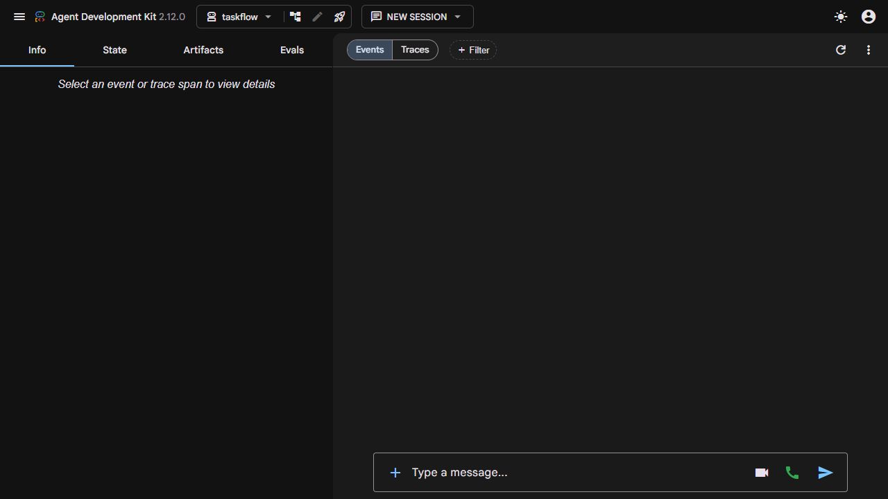

# DIO TaskFlow

Agente Python que organiza tarefas no Trello a partir de uma conversa, usando
Google ADK, Gemini e py-trello. Projeto independente inspirado no
[agent04 da DIO](https://github.com/digitalinnovationone/agent-carbon-footprint/tree/main/agents/agent04).

## O que faz

- Na primeira resposta, consulta a data atual no fuso configurado e pergunta
  quais são as tarefas do dia. Para começar no ADK Web, envie “Oi”.
- Cria um card por tarefa, com nome, descrição e vencimento.
- Lista todos os cards abertos das três listas ou filtra pelo status.
- Move cards entre **A fazer**, **Em andamento** e **Concluído**.
- Ao concluir, marca também o vencimento como concluído; ao reabrir, remove a marca.

O agente usa um quadro configurado. Não possui ferramenta de excluir tarefas.
Se houver cards com o mesmo nome, deve pedir qual deles você quer alterar.

## Melhoria principal: datas com fuso explícito

A data escolhida é interpretada em `America/Sao_Paulo` e convertida para UTC
antes de ir ao Trello. Ao listar, o vencimento volta para o fuso local.
Assim, uma tarefa de 21/10/2026 às 00:00 é enviada como
`2026-10-21T03:00:00Z`, preservando o dia 21 na exibição de São Paulo.
Sem horário informado, o padrão é **23:59 local**, comunicado pelo agente.
O fuso de exibição do navegador/Trello também deve corresponder ao esperado.

Outros ajustes: status com ou sem acento, conexão centralizada, tratamento de
erros em todas as ferramentas, seleção do quadro por ID ou nome único e
movimentação por ID para distinguir tarefas com títulos iguais.

## Instalação local — Windows

Você precisa de Python com suporte às dependências fixadas e um navegador.
A versão fixada do ADK (2.12.0) exige Python 3.11+ nos metadados do pacote;
este projeto foi preparado com Python 3.12. O tutorial geral menciona 3.10+,
mas o requisito da versão instalada prevalece.
Trello e Google AI Studio são serviços web, sem aplicativos desktop obrigatórios.

Na pasta do projeto:

```powershell
python -m venv .venv
.\.venv\Scripts\python.exe -m pip install -r requirements.txt
Copy-Item .env.exemplo .env
```

Não execute a última linha se já preencheu `.env`, pois isso substituiria os
valores locais. A ativação da venv é opcional ao usar os caminhos acima.

## Quadro e credenciais

Siga o [guia de configuração](docs/configuracao.md). Crie um quadro com as listas:

1. A fazer
2. Em andamento
3. Concluído

Preencha `.env` na raiz com sua chave Gemini, chave e token Trello.
O segredo Trello é opcional no fluxo de token pessoal utilizado aqui.
O nome padrão é `DIO TaskFlow`; com outro nome, ajuste `TRELLO_BOARD_NAME`.
Se houver nomes duplicados, configure `TRELLO_BOARD_ID`.

`GEMINI_MODEL` é configurável. O padrão `gemini-flash-latest` é um alias móvel;
confira disponibilidade e cota para sua conta no AI Studio. Não é necessário
ativar cobrança para executar os testes offline. O acesso gratuito à API tem
limites que variam por modelo, conta e período.

```powershell
.\.venv\Scripts\python.exe scripts/check_config.py
```

O diagnóstico mostra somente campos preenchidos ou pendentes, nunca os valores.
Uma chave preenchida não significa que ela seja válida ou tenha cota disponível.

## Conversar no ADK Web

Execute da raiz que contém a pasta `taskflow/`:

```powershell
.\.venv\Scripts\adk.exe web --host 127.0.0.1 --port 8000
```

Nesta máquina, `iniciar.ps1` também inicia a interface sem ativar a venv.

Abra [localhost:8000](http://localhost:8000), selecione **taskflow** e envie:

> Oi! Quero organizar as tarefas de hoje.

> Crie “Estudar Python”, com descrição “Praticar funções”, para hoje às 18:00.

> Liste as tarefas em andamento.

> Comecei a tarefa Estudar Python.

> Concluí a tarefa Estudar Python.

A criação e movimentação alteram o quadro real. O agente só deve confirmar
sucesso quando a ferramenta confirmar. Falhas de rede podem ocorrer após uma
escrita; confira a listagem antes de repetir a criação para evitar duplicatas.
ADK Web é uma interface de desenvolvimento e deve ficar em localhost.

## Ferramentas

| Função | Responsabilidade |
| --- | --- |
| `get_temporal_context` | Data e hora atuais no fuso configurado |
| `adicionar_tarefa` | Valida data/hora e cria um card em A fazer |
| `listar_tarefas` | Lista cards com ID e vencimento local |
| `mudar_status_tarefa` | Move o card pelo ID e sincroniza conclusão |

As funções estão em [tools.py](taskflow/tools.py), registradas em
[agent.py](taskflow/agent.py). As regras de data e acesso ao quadro estão em
[core.py](taskflow/core.py). O Gemini decide qual função chamar; Python valida
os argumentos e executa a operação. Nome e descrição de card são dados, não
instruções para o agente.

## Testes e evidências

```powershell
.\.venv\Scripts\python.exe -m unittest discover -s tests -v
.\.venv\Scripts\python.exe -m pip check
```

Os testes substituem o Trello por objetos em memória e não gastam cota Gemini.
Cobrem virada de dia/ano, horários inválidos, acentos, listas ausentes,
quadros duplicados, movimentação, reabertura e proteção de segredos em erros.
Não provam a conexão real nem a escolha de ferramentas pelo modelo.

Após configurar as credenciais, valide o quadro real:

```powershell
# Somente leitura do Trello:
.\.venv\Scripts\python.exe scripts/smoke_trello.py
# Cria um card identificado como teste e move até Concluído:
.\.venv\Scripts\python.exe scripts/smoke_trello.py --write
```

O card de teste fica no quadro como evidência e pode ser arquivado manualmente.
O roteiro da conversa e dos prints está em [validacao.md](docs/validacao.md).
Resultados efetivamente executados estão em [docs/evidencias](docs/evidencias/README.md).
A integração real está pendente de configuração das contas e credenciais.



## Estrutura

```text
dio-taskflow/
  taskflow/             Agente, ferramentas e regras
  scripts/              Diagnóstico e teste do Trello real
  tests/                Testes offline
  docs/                 Configuração, validação e evidências
  requirements.txt      Dependências diretas fixadas
  requirements.lock.txt Ambiente completo validado
  .env.exemplo          Configuração sem segredos
  .gitignore            Exclui .env, .venv e sessões locais
```

Para reproduzir as versões transitivas validadas, use
`pip install -r requirements.lock.txt` na venv. O lock foi gerado no Windows
com Python 3.12; outras plataformas podem precisar resolver dependências novamente.

## Origem e referências

O código foi reimplementado para este desafio, preservando a proposta do agent04.
Referência consultada no commit `25877f05a345e13d9ea5c5de2513cb842d30f531`.
O restante do projeto de pegada de carbono não foi incluído.

- [ADK Python](https://adk.dev/get-started/python/)
- [Trello: chave e token](https://developer.atlassian.com/cloud/trello/guides/rest-api/api-introduction/)
- [py-trello](https://github.com/sarumont/py-trello)
- [Modelos Gemini](https://ai.google.dev/gemini-api/docs/models)

Nunca publique `.env`, tokens, chaves ou prints que os revelem. O token Trello
pode conceder acesso a mais quadros da conta; o aplicativo restringe operações
ao quadro configurado, mas isso não limita o alcance do token fora dele.
